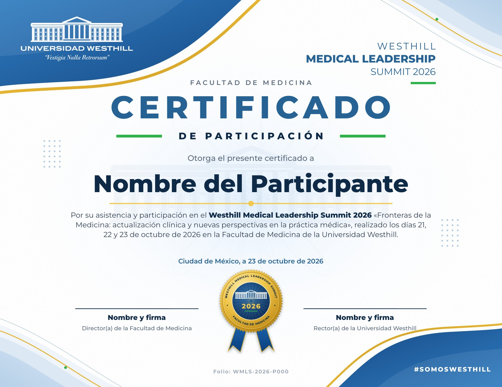

# Plantilla de diapositivas · Westhill Medical Leadership Summit 2026

Plantilla en PowerPoint (16:9) basada en la línea gráfica del flyer oficial del summit
(Facultad de Medicina, 21, 22 y 23 de octubre de 2026).


## Archivos

| Archivo | Para qué sirve |
|---|---|
| `Plantilla_Medical_Leadership_Summit_2026.pptx` | La plantilla, con 10 diapositivas de ejemplo. |
| `fuentes/` | Tipografía **Montserrat** (la del flyer). Instálala antes de abrir la plantilla. |
| `generar_plantilla.js` | Script que genera la plantilla (pptxgenjs). |
| `animate.py` | Agrega las transiciones de desvanecimiento y las animaciones "Flotar hacia dentro". |
| `img/` | Logo, foto de portada (tomada del flyer) y foto del campus. |

## Diseños incluidos (Inicio › Nueva diapositiva)

1. **Portada**: ola azul con filo dorado y logo, título en Montserrat ExtraBold, foto con resplandor celeste y banda azul inferior con la fecha entre guiones verdes.
2. **Portada de ponencia**: tipo (PONENCIA, MESA REDONDA…), título, ponente, cargo, foto circular del ponente y día/horario en la banda azul.
3. **Sección**: fondo azul, número grande en dorado, etiqueta (SECCIÓN / DÍA) y foto del campus recortada en curva.
4. **Título y contenido** y 5. **Contenido e imagen**: encabezado con la ola y el logo, pie azul con curva dorada y número de diapositiva.
6. **Solo título**: para composiciones libres (tablas, tarjetas, cifras, ponentes…).
7. **Receso**: coffee break con hora de regreso.
8. **Cierre**: fondo azul con la ola blanca y el logo a color.

## Diapositivas incluidas

Portada · Ceremonia de apertura (lema «Fronteras de la Medicina») · Programa día 1, 2 y 3 ·
El summit en cifras · Ponentes · Divisor de día · Portada de ponencia · Contenido e imagen ·
Puntos clave · Mensaje clave · Coffee break · Patrocinadores · Cierre.

El programa, los ponentes y las cifras salen de `Programa_Westhill.xlsx` (copiados en `PROGRAMA`
dentro de `generar_plantilla.js`). Las diapositivas 10 a 12 y los logos de patrocinadores son
**de ejemplo** y deben sustituirse.

## Regenerar

```bash
npm install pptxgenjs react react-dom react-icons sharp jszip
node generar_plantilla.js
```

---

# Certificados



| Archivo | Para qué sirve |
|---|---|
| `Certificados_Medical_Leadership_Summit_2026.pptx` | Carta horizontal (11 × 8.5 in), editable. Diapositiva 1: certificado de participación; 2: reconocimiento a ponente; 3 a 11: reconocimientos ya llenados para los ponentes del programa. |
| `Certificados_Medical_Leadership_Summit_2026.pdf` | Los mismos certificados listos para imprimir (fuentes incrustadas, fondo a 300 ppp). |
| `generar_certificado.js` | Genera los certificados. Si existe `participantes.txt` (un nombre por renglón) crea además `Certificados_participantes.pptx` con un certificado y folio por persona. |

Detalles del diseño: ola azul con filo dorado y logo (igual que la presentación) arriba a la izquierda
y abajo a la derecha; en las otras dos esquinas, un adorno ligero en diagonal con las olas. Edificio
del logo y roseta muy tenues de fondo, textura de papel, sello dorado con listones y folio. Los nombres
de los firmantes («Nombre y firma») deben completarse.

El adorno de las esquinas se elige con la variable `ESQUINAS` (ver `opciones_esquinas_certificado.jpg`):
`ondas` (predeterminado), `puntos` o `arcos`, por ejemplo `ESQUINAS=arcos node generar_certificado.js`.
