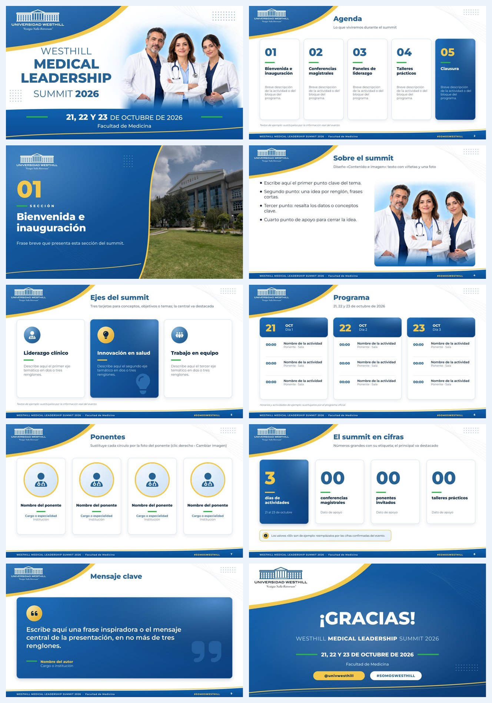

# Plantilla de diapositivas · Westhill Medical Leadership Summit 2026

Plantilla en PowerPoint (16:9) basada en la línea gráfica del flyer oficial del summit
(Facultad de Medicina, 21, 22 y 23 de octubre de 2026).



## Archivos

| Archivo | Para qué sirve |
|---|---|
| `Plantilla_Medical_Leadership_Summit_2026.pptx` | La plantilla, con 10 diapositivas de ejemplo. |
| `fuentes/` | Tipografía **Montserrat** (la del flyer). Instálala antes de abrir la plantilla. |
| `generar_plantilla.js` | Script que genera la plantilla (pptxgenjs). |
| `animate.py` | Agrega las transiciones de desvanecimiento y las animaciones "Flotar hacia dentro". |
| `img/` | Logo, foto de portada (tomada del flyer) y foto del campus. |

## Diseños incluidos (Inicio › Nueva diapositiva)

1. **Portada**: ola azul con filo dorado y logo, título en Montserrat ExtraBold, foto con resplandor celeste y banda azul inferior con la fecha entre guiones verdes.
2. **Sección**: fondo azul, número grande en dorado y foto del campus recortada en curva con filo dorado.
3. **Título y contenido**: encabezado con la ola pequeña y el logo, pie azul con curva dorada y número de diapositiva.
4. **Contenido e imagen**: texto a la izquierda y un marcador de imagen a la derecha.
5. **Solo título**: para armar composiciones libres (tarjetas, cifras, ponentes…).
6. **Cierre**: fondo azul con la ola blanca y el logo a color.

## Diapositivas de ejemplo

Portada · Agenda (5 tarjetas) · Sección · Contenido e imagen · Ejes del summit (3 tarjetas) ·
Programa por día · Ponentes · Cifras · Mensaje clave · Cierre.

Los textos de las diapositivas de ejemplo (agenda, ejes, horarios, ponentes, cifras «00») son
**de ejemplo** y deben sustituirse por la información real.

## Regenerar

```bash
npm install pptxgenjs react react-dom react-icons sharp jszip
node generar_plantilla.js
```
